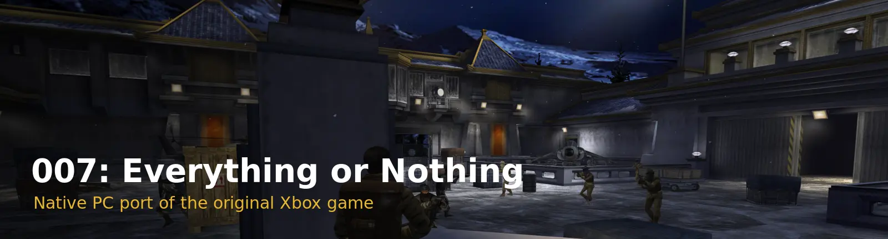
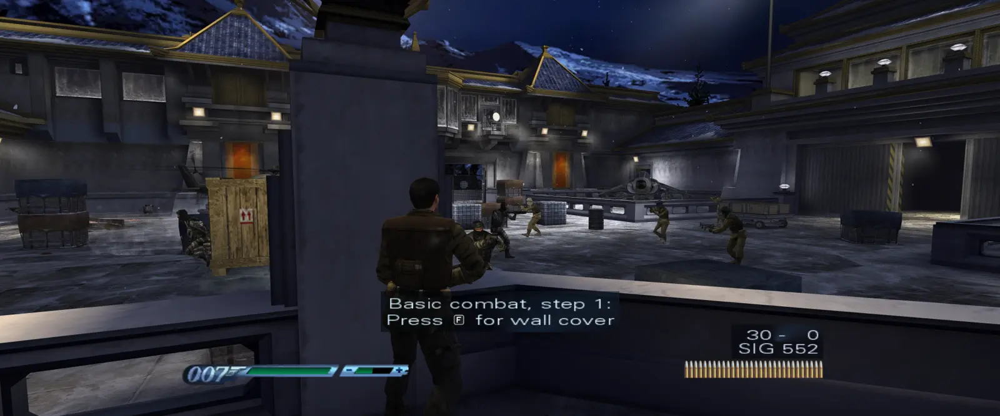
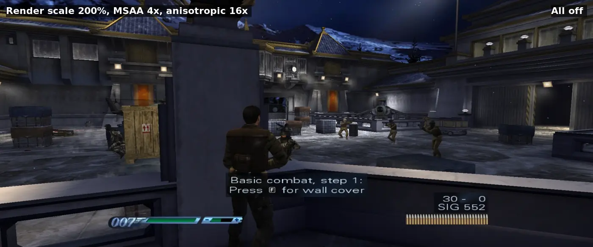
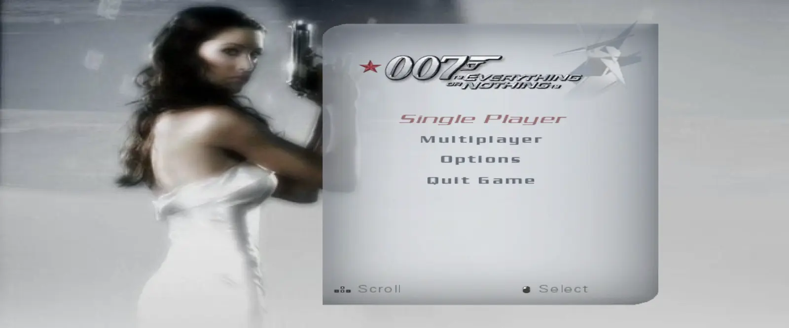
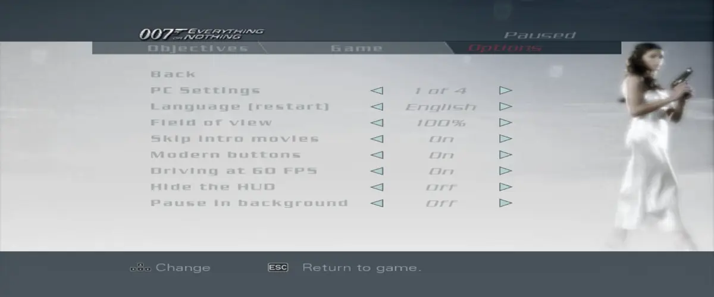
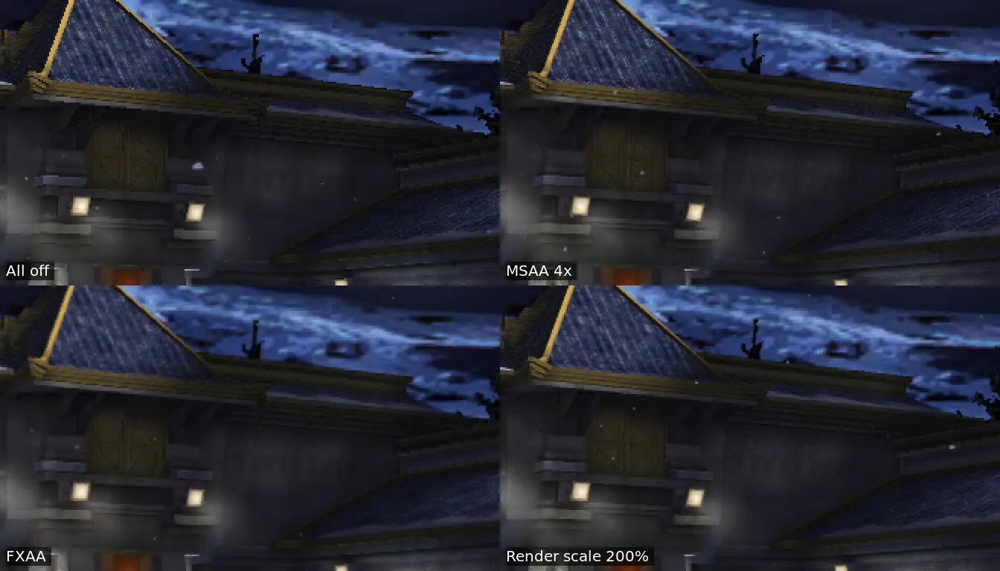
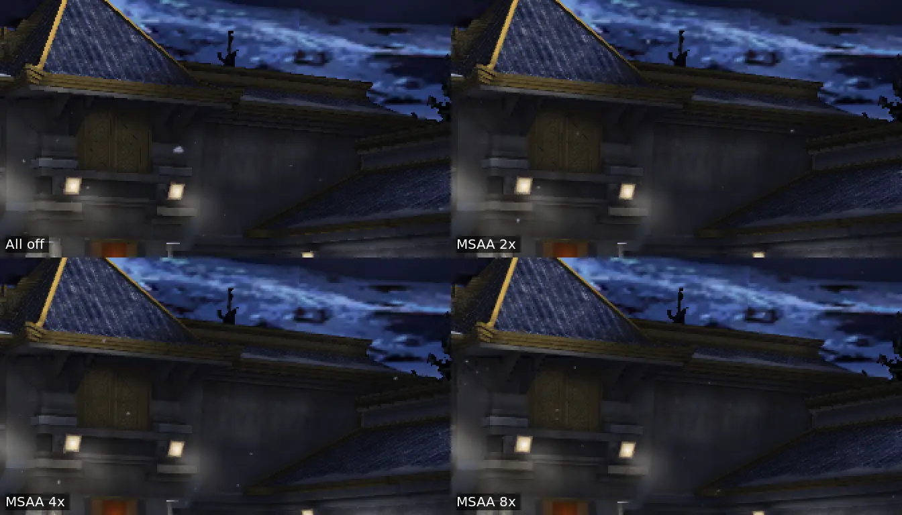
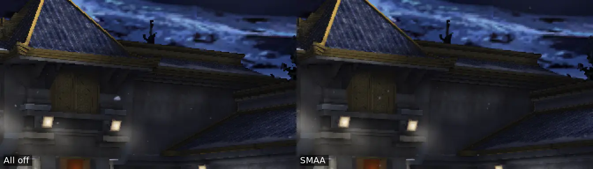
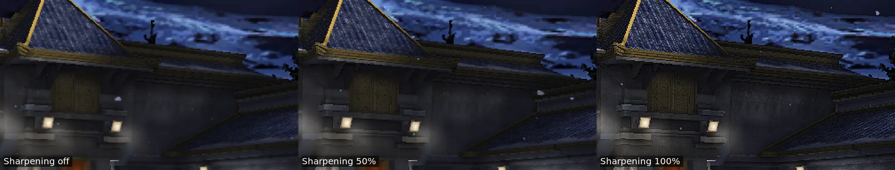

<p align="center">
  
</p>

<p align="center">
  
  
  
</p>

<p align="center">
  <a href="#getting-started"><b>Getting started</b></a> &nbsp;·&nbsp;
  <a href="#building"><b>Building</b></a> &nbsp;·&nbsp;
  <a href="https://discord.gg/PQjkKsdtc"><b>Discord</b></a>
</p>

<p align="center">
  
</p>

**The 2004 Xbox Bond game, running natively on PC.** This is not an emulator. The game's own x86 code, on foot and in
the driving missions, is statically recompiled with the [Xbox XBE Recomp](https://github.com/TGP482/XboxXBE-Recomp)
toolkit into Windows programs, with a new renderer, sound and input underneath: widescreen and ultrawide, driving
missions at 60 frames a second, sharper graphics, mouse aiming with a free-aim crosshair, modern pads, achievements,
and settings inside the game's own menus.

> [!NOTE]
> This project does not include any game assets. You need your own copy of the Xbox game to build and play.

## Table of contents

- [Xbox vs. PC](#xbox-vs-pc)
- [Features](#features)
- [Widescreen and the driving missions](#widescreen-and-the-driving-missions)
- [PC Settings](#pc-settings)
- [Graphics settings](#graphics-settings)
- [Controls](#controls)
- [Achievements](#achievements)
- [Requirements](#requirements)
- [Getting started](#getting-started)
- [FAQ](#faq)
- [Known issues](#known-issues)
- [Roadmap](#roadmap)
- [Community and support](#community-and-support)
- [Building](#building)
- [Credits and legal](#credits-and-legal)

## Xbox vs. PC
<sup>[(Back to top)](#table-of-contents)</sup>

<p align="center">
  
  <br>
  <i>All extras off vs. render scale 200%, MSAA 4x and anisotropic filtering 16x, at 1920x800 (21:9). Both from one run: the second changed in the pause menu.</i>
</p>

The Xbox drew Everything or Nothing at 640x480, at 4:3 or in its own 16:9 mode, with the driving missions at 30
frames a second. The port draws it at your screen's resolution and shape, the driving missions at 60, with
anti-aliasing and sharpening layered on top of the game's own picture.

## Features
<sup>[(Back to top)](#table-of-contents)</sup>

| | |
|---|---|
| **Widescreen and ultrawide** | The game's own 16:9 mode, and with Aspect **Fill** the 3D view widens to 21:9 or wider; the HUD and menus keep their 16:9 shape in the middle. |
| **Widescreen driving** | The driving missions, 4:3 on the console, widen to the screen's shape too, with the scenery drawn out to the edges. |
| **Driving at 60** | The driving missions draw 60 frames a second instead of 30, the game's timing unchanged. Above 60 is an experimental option. |
| **Sharper graphics** | Render scale, MSAA up to 8x, FXAA or SMAA, sharpening, anisotropic filtering, and sharp text and HUD pictures. |
| **PC Settings in the game** | Options > **PC Settings** in the main menu and the pause menu, in the game's own style. Everything is also in the F1 window and `settings.toml`. |
| **Mouse and keyboard** | Direct mouse aiming, free aim with a crosshair (from the hip, in wall cover, on the rope, through a scope), a small round lock-on dot, rebindable keys and button prompts that show your keys. |
| **Controllers** | Xbox, PlayStation and Switch pads with hot plugging and rumble. Modern button pictures show today's Xbox pad. |
| **Achievements** | 39 achievements (every mission, medals, 00 Agent, Bond moments) with pop-ups and a list in the settings window. |
| **Quality of life** | Skip intro movies, field of view, Hide HUD, Quit Game in the main menu, smooth slow motion in the driving missions, a shader cache against stutter, F12 screenshots. |
| **Both releases** | The European discs and the USA disc, each recompiled with its own configuration. |

## Widescreen and the driving missions
<sup>[(Back to top)](#table-of-contents)</sup>

<p align="center">
  
  <br>
  <i>The main menu at 1920x800 (21:9).</i>
</p>

On foot the game's 16:9 mode is used; with Aspect **Fill** (`aspect = "screen"`) the 3D view widens further to fill a
21:9 or wider screen, while the HUD and menus keep their 16:9 shape in the middle. The driving missions, which the
console drew only at 4:3, widen the same way, with their HUD and radar kept at 16:9. **Field of view** (50 to 150%)
widens or narrows the view on foot; cutscenes widen with it.

The game is two programs: the driving missions are a second xbe that the game launches and returns from. Both are
recompiled, into `EoN.exe` and `EoNDriving.exe`, and the switch between them happens on its own.

## PC Settings
<sup>[(Back to top)](#table-of-contents)</sup>

<p align="center">
  
  <br>
  <i>PC Settings in the pause menu, pages 1 to 3 (render scale, MSAA and anisotropic filtering raised for the wipe above).</i>
</p>

The port's options live in the game's **Options** menu, in the main menu and in the pause menu's Options tab: the first
row turns the page, left and right (or a click) change a value.

| Page | Settings |
|---|---|
| **Game** | Language, field of view, skip intro movies, modern buttons |
| **Driving and HUD** | Driving at 60 FPS, hide the HUD, pause in background, smooth slow motion |
| **Display** | Display mode, resolution, vertical sync, aspect |
| **Graphics** | Render scale, MSAA, edge smoothing (FXAA, SMAA), anisotropic filter, frame rate cap, show FPS, sharp text and HUD, renderer |
| **Mouse** | Keyboard play, mouse look, invert mouse, mouse sensitivity, aim sensitivity, sensitivity while aiming, camera follows movement, aim height |

The main menu shows four settings a page, the pause menu seven. **F1** opens the settings window over the game, with
the same settings and more: free aim, the lock-on dot, key bindings, the monitor and the controller options.
Everything is saved at once in `settings.toml` beside the game.

**Language** takes effect at the next start and carries into the driving missions. Each disc has its own languages:
English, Spanish, Italian, Dutch and Swedish on one European disc, French and German on the other, English alone on the
US disc.

## Graphics settings
<sup>[(Back to top)](#table-of-contents)</sup>

Shots of one spot at 1920x800, taken one after another on an Intel Arc A750; the close-ups are enlarged twice.

<p align="center">
  
  <br>
  <i>Edges: all off, MSAA 4x, FXAA and render scale 200%.</i>
</p>

- **MSAA** smooths the edges of the 3D scene and keeps textures sharp. The more samples, the slower.

<p align="center">
  
  <br>
  <i>MSAA off, 2x, 4x and 8x.</i>
</p>

- **Edge smoothing** works on the finished frame, HUD included: FXAA softens it a little, SMAA keeps it crisper.

<p align="center">
  
  <br>
  <i>Edge smoothing off vs. SMAA.</i>
</p>

- **Render scale** draws the picture larger than the screen: the smoothest fine detail, and the slowest.
- **Sharpening** brings out texture detail that the smoothing settings soften. Around 50% is a good start.

<p align="center">
  
  <br>
  <i>Sharpening off, 50% and 100%.</i>
</p>

- **Anisotropic filtering** keeps floors and walls sharp into the distance.
- **Sharp text and HUD** enlarges the text, menus' and HUD's pictures with sharp edges for high resolutions.
- **Modern button pictures** show today's Xbox pad (A B X Y, LB and RB in place of White and Black, the Menu and View
  buttons), drawn at four times the console's resolution.
- **Shader cache:** compiled shaders are kept in `shadercache.bin`, so each is compiled once rather than in every
  session.

## Controls
<sup>[(Back to top)](#table-of-contents)</sup>

On foot (two keys per input, rebindable in F1 > Controls):

| Action | Keyboard and mouse | Pad |
|---|---|---|
| Move | W A S D | left stick |
| Look and aim | mouse | right stick |
| Fire | left mouse button | RT |
| Aim (free aim) | right mouse button | |
| Lock on | middle mouse button (hold) | LT |
| Zoom a scope or a mounted gun | mouse wheel | |
| Reload (free aim) | R | |
| Action, jump, confirm | Space, Enter | A |
| Dive roll, back in the menus | Left Ctrl, Backspace | B |
| Punch left / right | Q / E | X / Y |
| Crouch | C | White (LB) |
| Wall cover | F | Black (RB) |
| Next weapon | mouse wheel (free aim), Down, 2 | d-pad |
| Pick a weapon (free aim) | 1 to 6; X the last weapon | |
| Weapons and gadgets | arrow keys, 1 to 4 | d-pad |
| Stick clicks | V or Left Shift / T | L / R |
| Pause / Back | Esc, P / Tab | Start / Back |
| Screenshot | F12 | |
| Settings window | F1 | |

With free aim (on by default for the mouse) shots go to a crosshair in the middle of the view, also from the hip; in
wall cover, at its edge, the right button leans out to aim; on the rope the mouse turns the view down the wall. In the
menus the mouse shows a pointer: point and click, the wheel scrolls, the right button goes back.

The driving missions have keys of their own:

| Action | Keyboard and mouse |
|---|---|
| Gas / brake and reverse | W / S |
| Steer | A / D, or the arrow keys |
| Handbrake | Space |
| Fire weapon / fire gadget | left mouse button or Enter / right mouse button or E |
| Action | F |
| Next weapon | mouse wheel, R, or 3 / 4 |
| Full screen map | M |
| Look back / centre the camera | C / V or middle mouse button |
| Aim a tank's or the helicopter's gun | mouse |
| Helicopter: climb / descend | E / Q |
| Change camera | 1 |
| Bond sense | Tab |
| Pause | Esc, P |

## Achievements
<sup>[(Back to top)](#table-of-contents)</sup>

39 achievements: every mission, medals, 00 Agent and Bond moments, with pop-ups and a list in the settings window.
They are written in RetroAchievements' condition format; the set and its memory map are in
[ACHIEVEMENTS.md](ACHIEVEMENTS.md).

## Requirements
<sup>[(Back to top)](#table-of-contents)</sup>

- **Your own copy of the game:** the European (PAL) or USA (NTSC) Xbox release, title id 45410042. An `.iso` image of
  your disc, or a folder with its files.
- **Windows 10 or 11, 64 bit**, and a graphics card with Direct3D 12 or Direct3D 11 (F1 > Graphics > Renderer; applies
  at the next start). Smooth slow motion needs Direct3D 12.
- About 1 GB free, plus room for your copy of the game.

Supported discs (the log names the SHA-1 of each xbe it found):

| Release | `default.xbe` (on foot, menus) SHA-1 | `driving.xbe` (the driving missions) SHA-1 |
| --- | --- | --- |
| Europe (English, Spanish, Italian, Dutch, Swedish) | `65fe0c47889bae5732b93e36215b564c94df9e9f` | `93390d82f2a7dd5371fd6d7b725577e806e4f09e` |
| Europe (French, German) | `0d2acd66ea75949254916f1f91f7bf31beac9bbe` | `08a873cfff115a77164405f7f93890e04ad395f0` |
| Europe, media check patched | `62298fe4e618d9d81863080fb1b00c1667d871c9` | `da2b27d66d4b5f23af47421b9572fcad06669d22` |
| Europe (French, German), media check patched | `5fa988c4f64be2527a1fe713e003c6aaeb9d395f` | `f9aecc24ff0e7119050e826616659548036448c3` |
| USA | `1f4db3b7d3f5102ec7a2351e521f545ef4972be6` | `ef1f8404d459feda02fbbe1ea8641569015280d7` |
| USA, media check patched | `e0e44575d4df16c85d9d240d2d2a0b8d1c6e2bd1` | `64220c179f58f47d17aba0c3fdb11816537d44c1` |

Both European discs hold the same code; the USA disc is another build of the game, which the build recognises by its
`default.xbe` and recompiles with its own configuration (`config/usa_*.toml`).

## Getting started
<sup>[(Back to top)](#table-of-contents)</sup>

`EoNLauncher.exe` does everything for you: no Visual Studio, no Git, no command line, nothing installed in Windows and
no admin rights needed. It builds the game's code on your own PC from your own disc: the game's code is never
downloaded, only the program around it.

1. Download `EoNLauncher.exe` from the [latest release](https://github.com/hk21x/007eon-recomp/releases/latest).
2. Put it in a folder of its own with a short path (for example `C:\Games\EoN`) and run it. Everything it makes goes in
   an `EoN` folder beside it. Windows may warn about an unrecognised app: choose **More info**, then **Run anyway**.
3. **Your game:** choose your disc image or the folder with the disc's files. The launcher checks that it is a
   supported release.
4. **Get the game ready:** the launcher downloads your disc's package (the program and a compiler, no game code; under
   100 MB), then your PC builds the game's code from your disc, in a minute or so on a recent PC. You can stop at any
   time; it carries on where it left off.
5. **Play:** press **Play**. In the game, **F1** opens the PC settings.

When a new release is out, the launcher offers it at the top of its window: **Update the launcher** downloads it,
checks it and restarts, then **Update** puts the new version in place, keeping your saves and settings. The new
version is built beside the game and only replaces it once it is ready, so a failed or stopped update leaves the game
as it was.

**Coming from 1.0.3 or earlier:** those versions built everything from source with about 1.4 GB of tools. The new
launcher shows **A faster way to play**: press **Update**. Your saves and settings are kept. Afterwards, **Manage >
Remove the old build tools** frees the space they took.

The launcher's pages: **Game** (your disc, the steps, Play), **Manage** (the install, its folders, removing build
files, building the game again if it will not start) and **Log**. Files, all under the `EoN` folder beside the
launcher:
- `play\` the game: `EoN.exe` and `EoNDriving.exe`, `EoN.dll` and `EoNDriving.dll` (the game's code, built on your PC),
  `settings.toml`, `hdd\` (saves), `logs\` (the game's logs), `compiler\` (what builds the code)
- `launcher.log` the launcher's log (send it with any problem)

To remove everything, delete the launcher and its `EoN` folder (keep `play\hdd` if you want your saves).

## FAQ
<sup>[(Back to top)](#table-of-contents)</sup>

<details>
<summary><b>Is this an emulator?</b></summary>
<br>
No. The game's x86 code is translated ahead of time into C++ and built as Windows programs. The Xbox's graphics,
sound and input are rebuilt for the PC underneath it. That is what makes ultrawide driving missions, free aim and
settings inside the game's menus possible.
</details>

<details>
<summary><b>Why a recompilation?</b></summary>
<br>
Everything or Nothing never came out on PC. A recompilation makes the Xbox game itself a present-day Windows program:
<ul>
<li><b>The whole game is ours to change.</b> A feature is a change in source and in our own renderer, not a patch laid
over a closed program. Free aim, the widened driving missions and PC Settings in the game's own menus were built that
way.</li>
<li><b>One runtime for several games.</b> Widescreen, anti-aliasing, controllers, achievements and the settings window
come from the toolkit this port shares with other Xbox ports, and a fix made for one reaches the others.</li>
<li><b>A present-day program.</b> 64 bit and Direct3D 12, with no emulator to set up.</li>
</ul>
</details>

<details>
<summary><b>Why do I need my own copy of the game?</b></summary>
<br>
The game belongs to its rights holders. This project shares only its own work: the game's code and assets are made
from your disc when you build.
</details>

<details>
<summary><b>The first time a new area or effect appears, it stutters.</b></summary>
<br>
Its shaders are being compiled. They are kept in <code>shadercache.bin</code>, so it does not happen there again; the
log's <code>frames:</code> lines say how many were compiled.
</details>

<details>
<summary><b>Does it run on Linux or the Steam Deck?</b></summary>
<br>
Not supported, but reported working through Proton or Wine (on a ROG Ally X with Bazzite). If the game runs but shows
nothing, or its log has <code>compile failed</code> lines, Wine's own shader compiler is rejecting the shaders: install
Microsoft's into the game's prefix. In Desktop Mode, with the game closed, run <code>protontricks -l</code>, find the
launcher's App ID (a line such as <code>Non-Steam shortcut: EoNLauncher (1234567890)</code>), then run
<code>protontricks 1234567890 d3dcompiler_47</code> with that number and start the game again. If it then stops on a
loading screen, rebuild it in the launcher.
</details>

<details>
<summary><b>Can it go straight into the game, from Steam Big Picture say?</b></summary>
<br>
Yes. Tick <b>Start the game when the launcher opens, if nothing needs updating</b> under Play, or add
<code>--play</code> to the shortcut's launch options (in Steam: the shortcut's Properties). The launcher still checks
for a new version first and stays open when there is one to install. Hold Shift as it opens to stay in it.
</details>

<details>
<summary><b>How do I start again from a first boot?</b></summary>
<br>
Delete the <code>hdd</code> folder beside <code>EoN.exe</code> (<code>EoN\play\hdd</code> with the launcher,
<code>out\build\release\hdd</code> when built from source). This deletes your saves.
</details>

<details>
<summary><b>Something is wrong. What should I send?</b></summary>
<br>
The first lines of the log in <code>logs\</code> list your settings, GPU and any <code>XBE_*</code> or
<code>EON_*</code> environment variables (leftover ones from experiments change how the game runs). Please include that
file, and <code>EoN\launcher.log</code> if the launcher's build failed, when you report a problem on the
<a href="https://github.com/hk21x/007eon-recomp/issues">issue tracker</a> or the
<a href="https://discord.gg/PQjkKsdtc">Discord server</a>. After a network problem, press the launcher's button again:
it carries on where it stopped.
</details>

## Known issues
<sup>[(Back to top)](#table-of-contents)</sup>

- **On foot the game runs at 60** frames a second; frame rates above 60 are only in the driving missions, as an
  experimental option (High frame rate, F1 > Game) that can show some flicker.
- **Smooth slow motion** is Direct3D 12 only; Direct3D 11 shows slow motion in steps, as the console did.
- **Smooth slow motion can ghost** on fast movement; turn it off in PC Settings to see the console's steps.
- **Linux and the Steam Deck** need Microsoft's shader compiler in the prefix (see the FAQ).

## Roadmap
<sup>[(Back to top)](#table-of-contents)</sup>

- **Frame rates above 60 on foot.**
- **High frame rates in the driving missions** out of experimental.
- **More screen shapes**, 16:10 among them.

Progress is in [PROGRESS.md](PROGRESS.md), and technical findings in [FINDINGS.md](FINDINGS.md).

## Community and support
<sup>[(Back to top)](#table-of-contents)</sup>

Join the [Discord server](https://discord.gg/PQjkKsdtc) for help getting the game running, to report problems, and to
talk about the port with other players. Bugs can also go on the
[issue tracker](https://github.com/hk21x/007eon-recomp/issues).

## Building
<sup>[(Back to top)](#table-of-contents)</sup>

For developers. **You need:** Windows 10 or 11 (64 bit), [Git](https://git-scm.com/download/win), Visual Studio 2022
(Community is fine) with **Desktop development with C++** (`build.bat` offers to add **C++ Clang tools for Windows**
and **C++ CMake tools for Windows**), about 3 GB free, and your disc's files: `default.xbe`, `driving.xbe` and the
game's folders.

1. Clone the repository with its SDK:
   ```
   git clone --recurse-submodules https://github.com/hk21x/007eon-recomp.git
   cd 007eon-recomp
   ```
   Cloned without `--recurse-submodules`? Run `git submodule update --init`.
2. Put your game files in the `assets` folder: `assets\default.xbe` with `driving.xbe` and the game's folders beside
   it.
3. Run `build.bat`. The first build recompiles both xbe files and takes a while; later builds are quicker. On Windows
   the game's code is built into `EoN.dll` and `EoNDriving.dll` beside the exes.
4. Run `out\build\release\EoN.exe`. It finds the `assets` folder beside itself or in any folder above it.

`launcher.bat` builds `EoNLauncher.exe` itself. `release-package.bat`, after `build.bat`, makes the package for a
release: once with a European disc in `assets` and once with the USA disc, each in a checkout of its own. Files the
game writes beside the exe: `settings.toml`, `hdd\` (saves), `logs\`, `shadercache.bin` (compiled shaders) and
`CrashDumps\` if it crashes. A `splash.png` (or `.bmp`) beside the exe is shown at launch; frame captures (F3) need
`XBE_CAPTURE_DIR` set.

## Credits and legal
<sup>[(Back to top)](#table-of-contents)</sup>

- [Xbox XBE Recomp](https://github.com/TGP482/XboxXBE-Recomp), the recompiler and runtime this is built on.
- [XenonRecomp](https://github.com/hedge-dev/XenonRecomp) for the overridable function layout and instruction hooks.
- [Zydis](https://github.com/zyantific/zydis) for decoding x86 instructions, [toml++](https://github.com/marzer/tomlplusplus)
  for the configs, [Dear ImGui](https://github.com/ocornut/imgui) for the settings overlay and
  [SDL](https://github.com/libsdl-org/SDL) for the window, input and controllers.

*007: Everything or Nothing* © its respective rights holders. Developed by EA Redwood Shores and published by Electronic Arts. James Bond
and 007 are trademarks of their owners. This is an unofficial fan project, not affiliated with or endorsed by them. No
game code or assets are distributed: they are made from your own copy of the game.

**AI disclosure:** much of this project's code, tooling and documentation was written with AI assistance (Anthropic's
Claude), directed, reviewed and playtested by the author.
