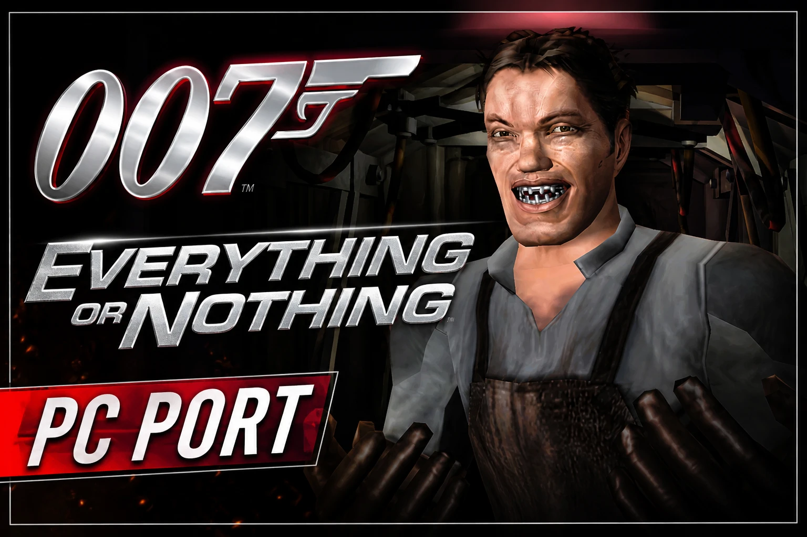

# 007: Everything or Nothing - XBE Recomp



An unofficial native PC port of the original Xbox version of 007: Everything or Nothing, with extended graphics
options and other enhancements. The game's own x86 code is statically recompiled into Windows executables with the
[Xbox XBE Recomp](https://github.com/TGP482/XboxXBE-Recomp) tool; the Xbox's graphics, sound and system libraries are
reimplemented for Windows (Direct3D 12 or 11, XAudio2, SDL). It is not an emulator.

> [!NOTE]
> This project does not include any game assets. You must provide the files from your own legally acquired copy of
> the game to build and play.

## Supported Versions

The European (PAL) Xbox releases of 007: Everything or Nothing (title id 45410042). Both European discs hold the
same code and work:

| Release | `default.xbe` (on foot, menus) SHA-1 | `driving.xbe` (the driving missions) SHA-1 |
| --- | --- | --- |
| Europe (English, Spanish, Italian, Dutch, Swedish) | `65fe0c47889bae5732b93e36215b564c94df9e9f` | `93390d82f2a7dd5371fd6d7b725577e806e4f09e` |
| Europe (French, German) | `0d2acd66ea75949254916f1f91f7bf31beac9bbe` | `08a873cfff115a77164405f7f93890e04ad395f0` |
| Europe, media check patched | `62298fe4e618d9d81863080fb1b00c1667d871c9` | `da2b27d66d4b5f23af47421b9572fcad06669d22` |

The game is two programs: the driving missions are a second xbe that the game launches and returns from. Both are
recompiled, into `EoN.exe` and `EoNDriving.exe`, and the switch between them happens on its own. The log names the
SHA-1 of each xbe it found. The USA (NTSC) release is a different build and is not supported yet.

## Getting Started

There are two ways to get the game running. Both build it on your own PC from your own disc: the game's code is
never downloaded, only the tools and this project's source.

### The launcher (recommended)

`EoNLauncher.exe` does everything for you: no Visual Studio, no Git, no command line, nothing installed in Windows
and no admin rights needed.

**You need:**
- Windows 10 or 11, 64 bit, and a GPU with Direct3D 12 or Direct3D 11.
- Your own copy of the game (PAL): an `.iso` image of your disc, or a folder with the disc's files.
- About 15 GB free, and an internet connection for the build tools.

**Steps:**
1. Download `EoNLauncher.exe` from the [latest release](https://github.com/hk21x/007eon-recomp/releases/latest).
2. Put it in a folder of its own (for example `C:\Games\EoN`) and run it. Everything it makes goes in an `EoN`
   folder beside it. Windows may warn about an unrecognised app: choose **More info**, then **Run anyway**.
3. **Your game:** choose your disc image or the folder with the disc's files. The launcher checks that it is the
   supported release.
4. **Build:** accept the license terms for Microsoft's C++ libraries and Windows SDK (the build uses them), then press
   **Build**. It downloads portable build tools (Clang, CMake, Ninja, Git and Microsoft's libraries), this project's
   source, and builds the game. The first build takes 30 to 90 minutes. You can stop it at any time; it carries on
   where it left off.
5. **Play:** press **Play**. In the game, **F1** opens the PC settings.

When this project is updated the launcher shows **Update**: press it, then Play.

Files, all under the `EoN` folder beside the launcher:
- `play\` the game: `EoN.exe`, `EoNDriving.exe`, `settings.toml`, `hdd\` (saves), `logs\` (the game's logs)
- `launcher.log` the launcher's log (send it with any problem building)
- `tools\` and `source\` the build tools and the source

To remove everything, delete the launcher and its `EoN` folder (keep `play\hdd` if you want your saves).

### Building from source (developers)

**You need:** Windows 10 or 11 (64 bit), [Git](https://git-scm.com/download/win), Visual Studio 2022 (Community is
fine) with **Desktop development with C++** (`build.bat` offers to add **C++ Clang tools for Windows** and **C++ CMake
tools for Windows**), about 15 GB free, and your disc's files: `default.xbe`, `driving.xbe` and the game's folders.

1. Clone the repository with its SDK:
   ```
   git clone --recurse-submodules https://github.com/hk21x/007eon-recomp.git
   cd 007eon-recomp
   ```
   Cloned without `--recurse-submodules`? Run `git submodule update --init`.
2. Put your game files in the `assets` folder: `assets\default.xbe` with `driving.xbe` and the game's folders beside
   it.
3. Run `build.bat`. The first build recompiles both xbe files and takes 30 to 90 minutes; later builds are quicker.
4. Run `out\build\release\EoN.exe`. It finds the `assets` folder beside itself or in any folder above it.

`launcher.bat` builds `EoNLauncher.exe` itself. Files the game writes beside the exe: `settings.toml`, `hdd\` (saves;
delete it to start again from a first boot), `logs\`, `shadercache.bin` (compiled shaders) and `CrashDumps\` if it
crashes.

## Controls and Settings

**Settings window:** press **F1**. Display, graphics, game options and controls; changes are saved at once to
`settings.toml`.

**Keyboard and mouse** (remappable in the Controls tab, two keys per input):

| Action | Keys |
| --- | --- |
| Move | W A S D |
| Look and aim | Mouse |
| Fire / lock on | Left / right mouse button |
| Jump, confirm (A) | Space or Enter |
| B | Left Ctrl |
| Punch left / right (X / Y) | Q / E |
| Wall cover (Black) | C |
| White button | F |
| Weapons and gadgets (d-pad) | 1 to 4, or the arrow keys |
| Pause / Back | Esc or P / Tab |
| Stick clicks | V or Left Shift / middle mouse button |

In the menus the mouse wheel scrolls, the left button selects and the right button goes back.

**Driving missions** have a layout of their own (rebound apart from the on-foot keys, while driving):

| Action | Keys |
| --- | --- |
| Gas / brake and reverse | W / S |
| Steer | A / D, or the arrow keys |
| Handbrake | Space |
| Fire weapon / fire gadget | Left mouse button or Enter / right mouse button or E |
| Action | F |
| Next weapon | R, or 3 / 4 |
| Full screen map | M |
| Look back / centre the camera | C / V or middle mouse button |
| Change camera | 1 |
| Bond sense | Tab |
| Pause | Esc or P |

**Controllers:** Xbox, PlayStation and Switch controllers, with hot plugging and rumble.

## Features

### Display
- **Display Modes** - Fullscreen, borderless window or window, at any resolution the monitor offers.
- **Widescreen** - The game's own 16:9 mode on a widescreen display.
- **Ultrawide** - With `aspect = "screen"`, the 3D view widens to fill a 21:9 or wider screen; the HUD and menus keep
  their 16:9 shape in the centre.
- **Widescreen Driving** - The driving missions, 4:3 on the console, widen to the screen's shape too, with the scenery
  drawn out to the screen's edges (no pop-in at the sides); their HUD and radar keep their 16:9 shape in the centre.
- **Field of View** - `fov_percent` (50 to 150, 100 the game's) widens or narrows the view on foot; cutscenes widen
  with it.
- **Frame Rate** - Vsync, a frame rate cap and an FPS counter.

### Graphics
- **Render Scale** - Renders at a percentage of the screen.
- **Anisotropic Filtering** and **Antialiasing** (MSAA or FXAA).
- **Sharp Text and HUD** - The text, menus' and HUD's pictures are enlarged with sharp edges for high resolutions
  (`sharp_2d`, on by default).
- **Modern Button Pictures** - The prompts show today's Xbox pad: A B X Y in the modern style, LB and RB in place of
  the White and Black buttons, LT and RT, and the Menu and View buttons in place of Start and Back (`modern_buttons`,
  on by default). They are drawn at four times the console's resolution, so they stay sharp at 1440p and 4K.
- **Shader Cache** - Compiled shaders are kept in `shadercache.bin`, so each is compiled once rather than in every
  session, and later sessions do not stutter while they compile.

### Sound
- **Full Driving Mix** - The driving missions' music, speech and engine sounds, which the game mixes into six
  channels itself, are all heard on stereo speakers and headphones.

### Keyboard and Mouse
- **Mouse aiming** - The mouse turns the camera and aim directly (not through the stick's curve), with sensitivity and
  invert options; the cursor stays in the window while playing.
- **Mouse in menus** - The wheel scrolls, the left button selects and the right button goes back; in play the buttons
  do what they are bound to.
- **Keyboard prompts** - While you play on the keyboard and mouse, the game's button prompts show the keys and mouse
  buttons bound to them; they switch back when you pick up the controller.
- Every key and mouse button can be rebound in the settings window (F1, Controls tab).

### General
- **Launcher** - `EoNLauncher.exe`: choose your disc, Build, Play, Update; portable build tools, nothing installed.
- **60 FPS Driving** - The driving missions draw at 60 frames a second instead of 30, the game's timing unchanged
  (`driving_60fps`, on by default).
- **Quit Game** - The main menu has a Quit Game item under Options (where the console's unused Online item was), and
  the settings window (F1) has a Quit game button.
- **Achievements** - 39 achievements (every mission, medals, 00 Agent, Bond moments) with pop-ups and a list in the
  settings window, written in RetroAchievements' condition format; the set and its memory map are in
  [ACHIEVEMENTS.md](ACHIEVEMENTS.md).
- **Hide HUD** - Clears the HUD on foot and in the driving missions, for screenshots (`hide_hud`, F1 > Game; at
  once). The pause screens and menus stay.
- **Skip Intro Movies** - `skip_intro = true` goes past the THX, MGM and EA logos at start.
- **Cutscenes** - A PAL disc's cutscenes play (the game runs as on a PAL console at 60 Hz).
- **Saves** - Kept on an emulated hard disk beside the exe.

### Miscellaneous
- **Boot Splash** - Place a `splash.png` (or `.bmp`) beside the exe to display a splash screen at launch.
- **Diagnostics** - Logs in `logs\`, and frame captures (F3, with `XBE_CAPTURE_DIR` set).

## Status

Plays on foot and in the driving missions, with saves, up to the last mission; widescreen and ultrawide, keyboard
and mouse, sharp 2D and 60 FPS driving are in. Progress is in [PROGRESS.md](PROGRESS.md), and technical findings in
[FINDINGS.md](FINDINGS.md).

## Troubleshooting

- Something wrong: the first lines of the log in `logs\` list the settings, the GPU and any `XBE_*` or `EON_*`
  environment variables; leftover ones from experiments change how the game runs.
- The launcher's build failing: send `EoN\launcher.log`. Press Build again after a network problem: it carries on
  where it stopped.
- A short stutter the first time a new area or effect appears: its shaders are being compiled. They are kept in
  `shadercache.bin`, so it does not happen there again; the log's `frames:` lines say how many were compiled.
- A first boot again: delete the `hdd` folder beside `EoN.exe` (`EoN\play\hdd` with the launcher,
  `out\build\release\hdd` when built from source). This deletes your saves.

## System Requirements

- **OS** - Windows 10 or 11, 64 bit
- **GPU** - with support for Direct3D 12 or Direct3D 11 (F1, Graphics, Renderer; applies at the next start)

## Credits

- [Xbox XBE Recomp](https://github.com/TGP482/XboxXBE-Recomp), the recompiler and runtime this is built on.
- [XenonRecomp](https://github.com/hedge-dev/XenonRecomp) for the overridable function layout and instruction hooks.
- [Zydis](https://github.com/zyantific/zydis) for decoding x86 instructions, [toml++](https://github.com/marzer/tomlplusplus) for the configs, [Dear ImGui](https://github.com/ocornut/imgui) for the settings overlay and [SDL](https://github.com/libsdl-org/SDL) for the window, input and controllers.
